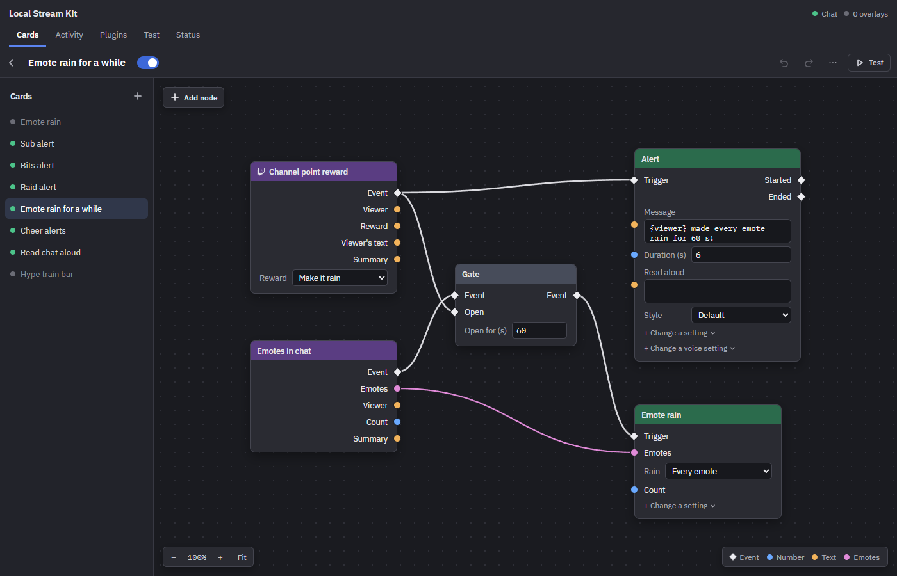
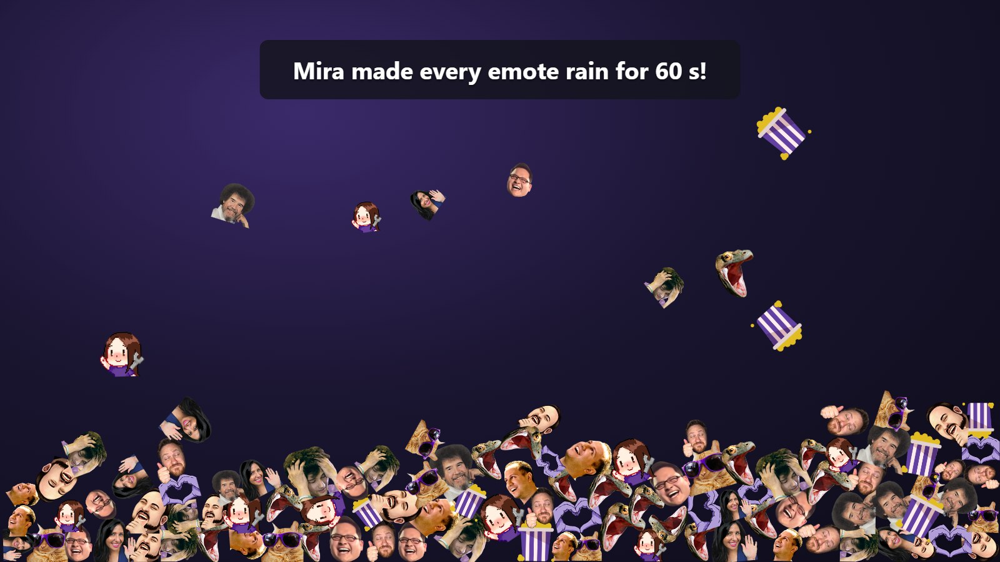

# Local Stream Kit

Emote rain, alerts, sounds and text to speech for your Twitch stream, on
your OBS overlay. You decide what sets off what by wiring up cards, and
it all runs on your own PC.



*A card: the "Make it rain" channel point reward lets every emote in chat
rain for a minute.*



*On stream, when a viewer redeems it.*

## Download

Get `lsk.exe` from the
[latest release](https://github.com/Local-Stream-Kit/Local-Stream-Kit/releases/latest). It
runs on Windows, with nothing to install.

It isn't code-signed yet, so Windows may warn you the first time:

- The browser may say `lsk.exe` isn't commonly downloaded: choose
  **Keep**.
- Windows may say it protected your PC: choose **More info**, then
  **Run anyway**.

New versions come to the app itself: it checks for updates when it
starts and every 12 hours (**Status → About → Updates** turns that
off). When one is out, Status says so, with
what's new. **Download** puts it in place of `lsk.exe`, and it runs from
the next time you start the app; nothing pops up during a stream. Your
settings stay. Before a new version changes the format of `lsk.json`,
it keeps a copy of the old one beside it (`lsk.v1.json`), so you can go
back. If `lsk.exe` is in a folder the app can't write to (such as
Program Files), download the new version from its release page instead.

## First start

1. Put `lsk.exe` in a folder of its own and double-click it. It keeps its
   settings and files (`lsk.json`, `pictures/`, `sounds/`, `plugins/`,
   `logs/`…) in the folder it's started from. A console window shows its
   log; closing it stops the app.
2. Open the control panel: <http://localhost:5750/panel/>. It works in a
   browser tab and as an OBS dock (Docks → Custom Browser Docks, with that
   address).
3. On **Status**, type your Twitch channel. Chat, emotes, bits, subs,
   gifted subs and raids then work without logging in. **Log in with
   Twitch**, with the broadcaster's account, adds channel points, follows,
   hype trains and, if you tick them first, moderating viewers from their
   cards in Activity (timeout, ban, warn) and making them VIPs and mods.
   Twitch is only asked for what's ticked.

## Setting up OBS

- **Start Local Stream Kit before OBS.** If OBS starts first, its Browser
  Source shows an error page and doesn't retry: press **Refresh cache of
  current page** in the source's properties. With OBS control set up
  (below), the app refreshes it for you.
- **The overlay:** on Status → Overlays, drag **Drag into OBS** onto OBS's
  preview, or add a **Browser** source with the overlay's link
  (`http://localhost:5750/`). Use `localhost`, not your PC's network
  address: animated emotes only work there.
- **Its size:** set the source's Width and Height to the size Status shows
  (`1920 × 1080`). Dragging the source's handles scales the page, which
  blurs it. With OBS control on, Plugins → OBS → Scaled overlays: Resize
  turns a drag into the right size for you.
- **Sounds:** tick **Control audio via OBS** to get them as their own
  source in the audio mixer. To hear them yourself, set that source's
  Audio Monitoring to **Monitor and Output**.
- **The chat display** is another Browser source, the Chat overlay
  (`http://localhost:5750/?overlay=chat`), sized and placed where the chat
  should go. Its look is under Plugins → Chat display.
- More overlays (Add an overlay, on Status) put effects on separate
  sources.
- **OBS control** (cards that switch scenes, show sources and the like):
  in OBS, Tools → WebSocket Server Settings → Enable WebSocket server,
  then put its password in the panel's Plugins → OBS.

## Stream Deck

The app has a Stream Deck plugin built in: keys that switch cards and
effects, run the alert queue, mute the sound and fire your own events,
showing what's on.

1. On **Status → Control API**, next to Stream Deck, click **Install**. Stream
   Deck (the app on this PC) asks whether to install it. Each release
   also has the plugin as a file of its own,
   `com.localstreamkit.streamdeck.streamDeckPlugin`: opening it does the
   same.
2. Drag a Local Stream Kit key onto your Stream Deck, and paste the
   **Address** from Status → Control API into the key's Address (once:
   every key shares it).

Status shows the plugin's version while it's connected. When the app is
updated and the plugin is older than the one in it, Status offers
**Update**. More in [streamdeck/README.md](streamdeck/README.md).

## More

- **Plugins:** every effect is a plugin, and you can add your own: an
  overlay page, server code in WebAssembly, or both.
  [docs/writing-a-plugin.md](docs/writing-a-plugin.md) has everything a
  plugin can do, and [examples/plugins](examples/plugins) has examples to
  start from.
- **Control API:** switch cards and effects, run the queue and fire your
  own events from a Stream Deck, a hotkey tool or a script:
  [docs/control-api.md](docs/control-api.md). [streamdeck/](streamdeck)
  has a Stream Deck plugin built on it.

## Building from source

On Windows, with [Rust](https://rustup.rs):

```bash
rustup target add wasm32-unknown-unknown wasm32-wasip2
```

```bash
cargo install trunk
```

```bash
cargo dist
```

`cargo dist` builds the overlay, the control panel, the built-in
plugins' pages and the Stream Deck plugin in release mode, then the app,
which embeds them: `target/release/lsk.exe` is all you need to run it.
The Stream Deck plugin needs [Node.js](https://nodejs.org) 24;
`cargo dist --no-streamdeck` leaves it out (Status then links to a
release's plugin file instead of installing one).

While working on it:

- `cargo run -p lsk -- --debug` runs the app from the repo root, reading
  the pages from disk. Build them once first (`cargo dist` or
  `cargo e2e` does), then run `trunk watch` in the crate you're changing
  (`crates/overlay`, `crates/panel`, `crates/rain`, `crates/alert` or
  `crates/chat`); open overlays and panels reload themselves when it
  rebuilds.
- `cargo test -p protocol -p lsk -p panel`: the unit tests.
- `cargo e2e`: the control panel end to end, in headless Edge or Chrome.
- `cargo plugin <folder>`: a plugin's Rust server code, built to its
  `server.wasm`.
- `cargo streamdeck`: the Stream Deck plugin on its own (needs Node.js
  24).
- `cargo run -p lsk --features streamdeck` builds the plugin
  `cargo streamdeck` made into the app, so Install works.

## Licence

Local Stream Kit is under the
[PolyForm Perimeter License 1.0.1](LICENSE.md): you may use, change and
share it, personally or commercially, but not to offer a product that
competes with it.

Required Notice: Copyright 2026 Martin Hagström

## Support the project

If you like it and want to support it: [PayPal](https://paypal.me/marhag87).
